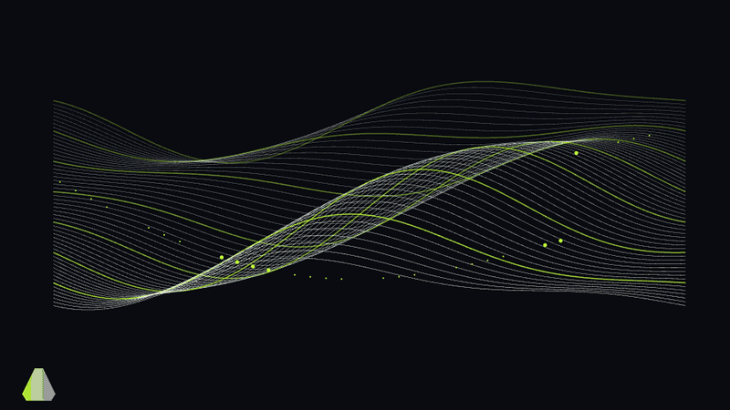
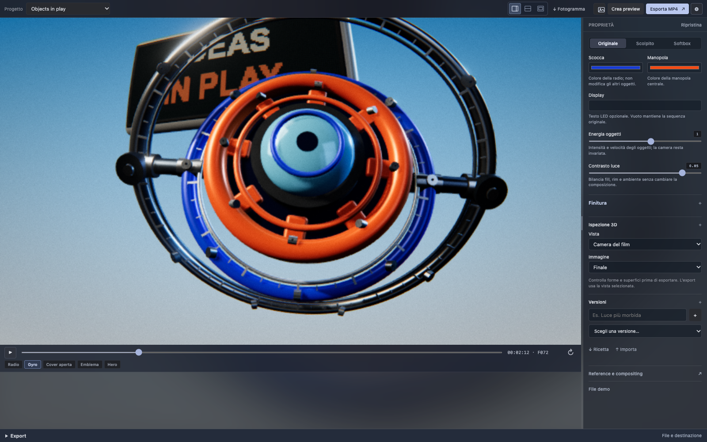
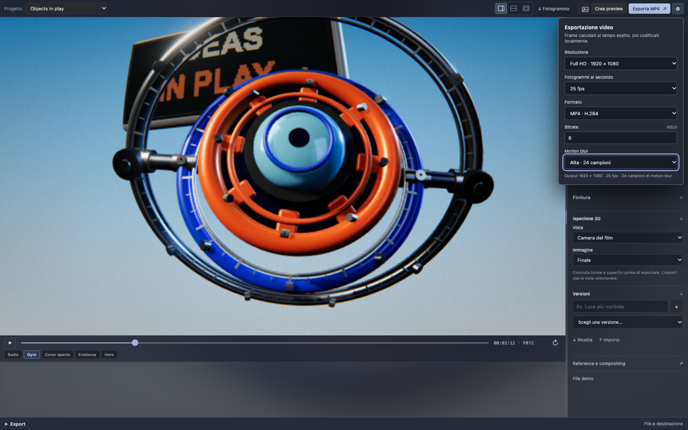
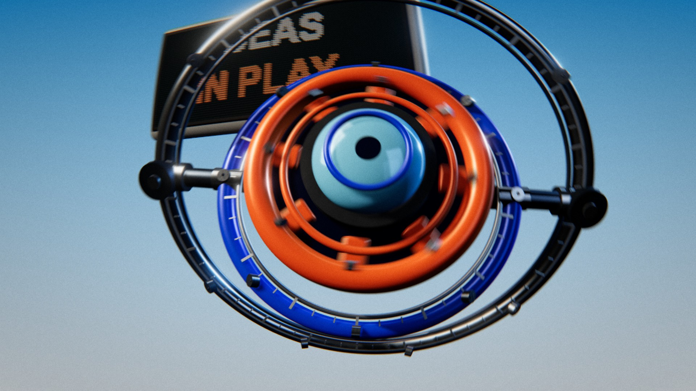

<div align="center">

# Motion Lab

**Rendering in codice per il vibe motion.**

Motion graphics 2D e scene 3D: codice, preview e render locale.


[Demo](https://andrexes03.github.io/motion-lab/) · [Installazione](#installazione) · [Architettura](docs/ARCHITECTURE.md) · [Guide](docs/README.md)

</div>

Con Codex o Claude puoi modificare scene, formule e ricette JSON, poi verificarle nel viewer. Camera, materiali e timing restano editabili: una correzione precisa non richiede una nuova generazione video da prompt, come con Seedance o Kling.

## Motion procedurale



Campi di flusso, toro parametrico, 720 elementi in trasformazione, onde e tunnel. Techno originale a 132 BPM e SFX legati al movimento.

[Video con audio](https://andrexes03.github.io/motion-lab/#procedural-video) · [MP4](demo/procedural-techno.mp4) · [Esempio live](https://andrexes03.github.io/motion-lab/examples/procedural-field.html) · [Codice e formule](src/scenes/procedural-demo.js)

After Effects e Cinema 4D hanno strumenti procedurali; qui la logica è direttamente nei sorgenti, leggibile e modificabile anche da un agente.

## Studio



Timeline, preset, camera e look. Ricette JSON salvabili e rendering con motion blur temporale.



Export MP4, WebM e ProRes, con risoluzione, frame rate, campioni e bitrate regolabili.

**Compositing:** profondità di campo 3D, occlusione ambientale, bloom, controllo delle alte luci, aberrazione cromatica, vignettatura e distorsione lente. Grana applicata dopo il motion blur e overlay 2D sopra il render. [Sorgenti](src/engine/composite.js).

**Sound design:** SFX legati ai movimenti 2D/3D, moduli regolabili e musica procedurale con BPM automatico o manuale. [Guida](docs/SOUND_DESIGN.md).

## Demo 3D

[](https://andrexes03.github.io/motion-lab/)

Objects in play è un test di luci, camera e cinematica.

**1080p · 25 fps · 24 campioni · obiettivo 6 Mb/s · SFX modulari.**

[Video nel browser](https://andrexes03.github.io/motion-lab/) · [MP4](demo/objects-in-play.mp4) · [Ricetta](demo/objects-in-play.project.json) · [Altre demo](demo/README.md)

## Installazione

Verificato su **macOS, Node.js 22.12+ e Google Chrome**. Internet necessario per la prima installazione.

```sh
git clone https://github.com/AndreXes03/motion-lab.git
cd motion-lab
npm ci
npm run viewer
```

Apri **http://127.0.0.1:4173/**. Gli export del viewer vanno in Download. Il build statico ha funzioni ridotte; Windows e Linux richiedono adattamenti e non sono verificati. [Uso ed export](docs/USAGE.md).

Render della demo:

```sh
npm run export -- --snapshot demo/objects-in-play.project.json --out renders/film.mp4 --width 1920 --height 1080 --fps 25 --temporal-samples 24 --bitrate-mbps 6
```

## Esplora

| Parte | Sorgenti / guida |
| --- | --- |
| Rendering, tempo e camera | [Motore](src/engine/) · [Architettura](docs/ARCHITECTURE.md) |
| Composizioni e oggetti | [Scene](src/scenes/) · [Componenti](src/components/) |
| Interfaccia e parametri | [Viewer](src/viewer/) · [Ricette JSON](project/README.md) |
| Rendering e verifiche | [Script](scripts/README.md) |
| Lavoro con agenti | [Workflow](docs/AGENT_WORKFLOW.md) |
| Tutte le guide | [Documentazione](docs/README.md) |

## Stato e licenze

In sviluppo. Import glTF non implementato. Dopo un passaggio 2D → 3D → 2D sono state rilevate differenze nei pixel: riapri la scena per i confronti. [Verifiche e limiti](docs/VALIDATION.md).

Codice di Andrea Salvo, [MIT](LICENSE). Marchi e asset demo conservano i rispettivi diritti. FFmpeg non incluso. [Dipendenze e avvisi](THIRD_PARTY.md).
