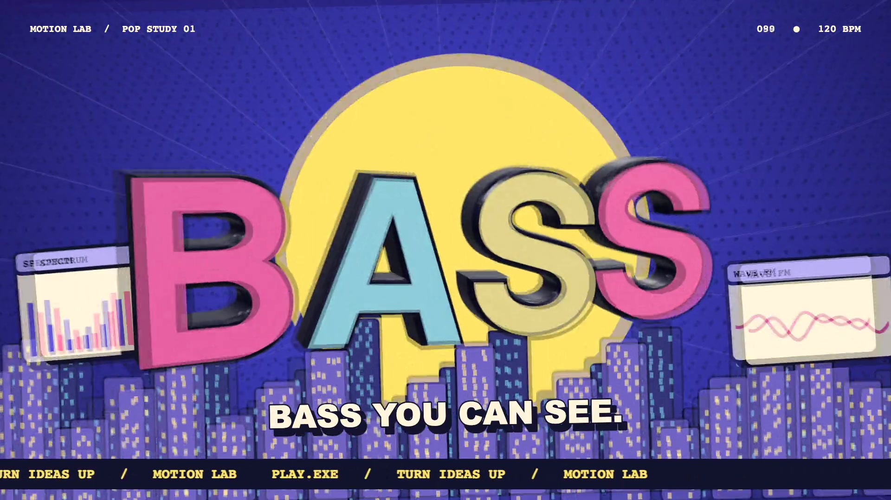
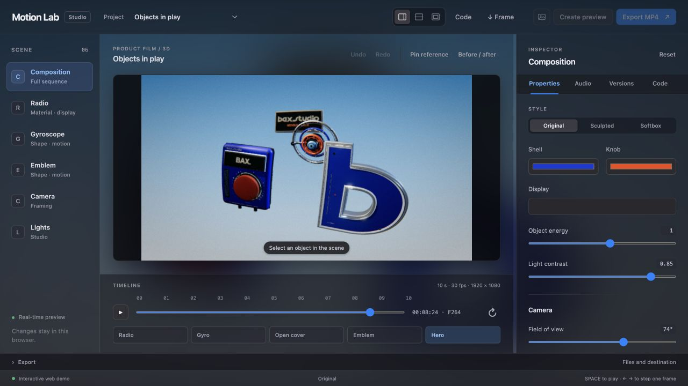

<div align="center">

# Motion Lab

**Code-driven rendering for vibe motion.**

2D motion graphics and 3D scenes: code, preview and local rendering.


[Demo](https://andrexes03.github.io/motion-lab/) · [Try the studio](https://andrexes03.github.io/motion-lab/studio/) · [Setup](#setup) · [Architecture](docs/ARCHITECTURE.md) · [Docs](docs/README.md)

</div>

Work with Codex or Claude on scenes, formulas and JSON recipes, then inspect the result in the viewer. Camera, materials and timing remain editable: precise changes do not require another prompt-based video generation.

## Four final films

Free, open-source Motion Lab: editable scenes, camera and sound, rendered locally from code.

| PULSE · 3D · 13.9 s | CAMERA · 3D · 15.4 s |
| --- | --- |
| [](https://andrexes03.github.io/motion-lab/#pulse) | [](https://andrexes03.github.io/motion-lab/#camera) |
| [Watch](https://andrexes03.github.io/motion-lab/#pulse) · [1080p MP4](demo/pulse-1080.mp4) | [Watch](https://andrexes03.github.io/motion-lab/#camera) · [1080p MP4](demo/camera-1080.mp4) |

| DOT · Hybrid · 16 s | REPLAY · Hybrid · 15 s |
| --- | --- |
| [](https://andrexes03.github.io/motion-lab/#dot) | [](https://andrexes03.github.io/motion-lab/#replay) |
| [Watch](https://andrexes03.github.io/motion-lab/#dot) · [1080p MP4](demo/dot-1080.mp4) | [Watch](https://andrexes03.github.io/motion-lab/#replay) · [1080p MP4](demo/replay-1080.mp4) |

All four films: **1920 × 1080 · 30 fps · sound design**. Hybrid combines 3D objects with 2D graphics and typography. PULSE/CAMERA include separately licensed music; see [credits](THIRD_PARTY.md).

## Pop Motion / 2D + 3D

[](https://andrexes03.github.io/motion-lab/?film=pop#demo)

A floating player, extruded lettering, comic halftones and a rhythmic city. **10 s · 1080p · 30 fps · 120 BPM.** Select PLAY.EXE in the viewer. [Video](demo/pop-motion.mp4) · [Recipe](demo/pop-motion.project.json) · [Tools and limitations](docs/POP_MOTION.md).

## Procedural motion


Flow fields, a parametric torus, 720 transforming elements, waves and tunnels. Original techno at 132 BPM, with movement-driven SFX.

[MP4](demo/procedural-techno.mp4) · [Live example](https://andrexes03.github.io/motion-lab/examples/procedural-field.html) · [Code and formulas](src/scenes/procedural-demo.js)

After Effects and Cinema 4D have procedural tools too. Here, the logic lives directly in source code, readable and editable by you and your coding agent.

## Reusable 3D baseline

The PULSE and CAMERA studio look is available as a [studio baseline](docs/3d-lookdev.md): wide optics, neutral shadows, rim lighting, restrained bloom, matte plastic/rubber/metal materials and temporal motion blur. Start new scenes from these helpers and preview before rendering at 1080p.

For detailed 3D exports, `--quality premium` selects 1080p, 48 temporal samples and resumable frames. For finer edges, `--quality supersampled` renders at 1440p for 1080p delivery. Use the clean/clay boards before a full render; see the [iteration workflow](docs/3d-lookdev.md#shorter-iteration-loop).

The repository includes a [product-film skill](.agents/skills/motion-lab-product-film/SKILL.md) for coding agents: model construction, lens choreography, impact recoil, efficient review and verified export. Codex discovers it from `.agents/skills`; other agents can read the same guide directly.

## Studio



Dark translucent panels with the current scene blurred behind the workspace. Contextual object, camera and lighting controls, undo/redo and a before/after comparison. Expand the Code panel to inspect live parameters or scene source.

[Try the English browser studio](https://andrexes03.github.io/motion-lab/studio/): preview scenes, adjust controls, save versions in your browser, download PNG frames and JSON recipes. Video rendering and project-file management require the local app.


MP4, WebM and ProRes export with adjustable resolution, frame rate, samples and bitrate.

**Compositing:** 3D depth of field, ambient occlusion, bloom, highlight control, chromatic aberration, vignette and lens distortion. Grain is applied after motion blur; 2D overlays stay above the render. [Source](src/engine/composite.js).

**Sound design:** movement-driven 2D/3D SFX, separate modules and procedural music with automatic or manual BPM. [Guide](docs/SOUND_DESIGN.md).

## 3D demo

[](https://andrexes03.github.io/motion-lab/)

Objects in play tests lighting, camera movement and kinematics.

**1080p · 25 fps · 24 samples · target 6 Mb/s · modular SFX.**

[Watch in browser](https://andrexes03.github.io/motion-lab/) · [MP4](demo/objects-in-play.mp4) · [Recipe](demo/objects-in-play.project.json) · [More demos](demo/README.md)

## Setup

Tested on **macOS, Node.js 22.12+ and Google Chrome**. Internet is needed for the first installation.

```sh
git clone https://github.com/AndreXes03/motion-lab.git
cd motion-lab
npm ci
npm run viewer
```

Open **http://127.0.0.1:4173/**. Viewer exports go to Downloads. The static build has fewer features; Windows and Linux require adaptation and are untested. [Usage and export](docs/USAGE.md).

Render the demo:

```sh
npm run export -- --snapshot demo/objects-in-play.project.json --out renders/film.mp4 --width 1920 --height 1080 --fps 25 --temporal-samples 24 --bitrate-mbps 6
```

## Explore

| Area | Source / guide |
| --- | --- |
| Rendering, time and camera | [Engine](src/engine/) · [Architecture](docs/ARCHITECTURE.md) |
| Compositions and objects | [Scenes](src/scenes/) · [Components](src/components/) |
| Interface and parameters | [Viewer](src/viewer/) · [JSON recipes](project/README.md) |
| Rendering and checks | [Scripts](scripts/README.md) |
| Working with agents | [Workflow](docs/AGENT_WORKFLOW.md) |
| All guides | [Documentation](docs/README.md) |

## Status and licenses

In development. glTF import is not implemented. Pixel differences were found after switching 2D → 3D → 2D: reopen the scene before comparisons. [Checks and limits](docs/VALIDATION.md).

Code by Andrea Salvo, [MIT](LICENSE). Demo trademarks and assets retain their respective rights. FFmpeg binaries are not included. [Dependencies and notices](THIRD_PARTY.md).
