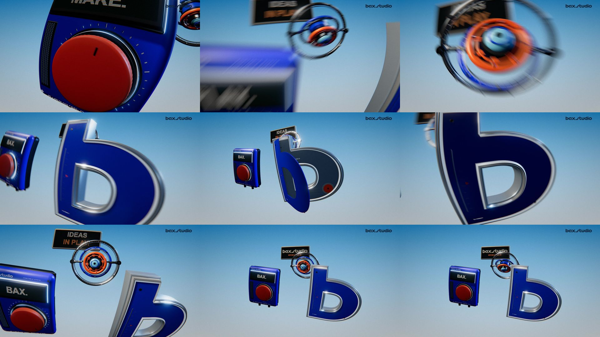
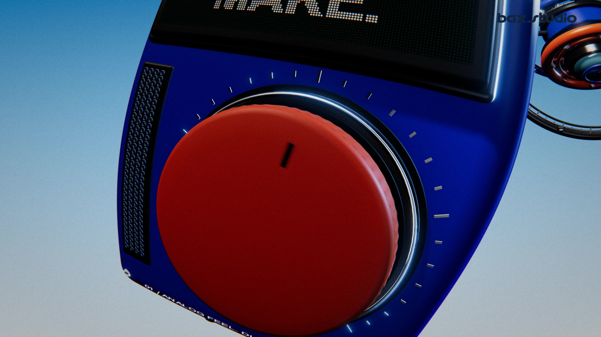
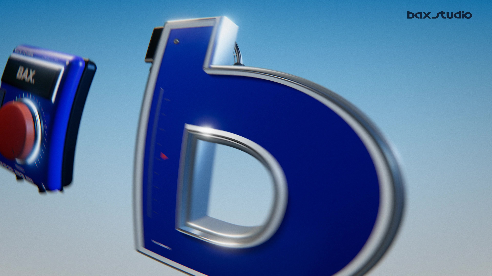

<div align="center">

# Motion Lab

**Scene 3D e motion graphics, costruite in codice.**

Uno studio locale per esplorare materiali, luci e movimenti di camera.<br>
Dal viewer interattivo al video, con gli stessi sorgenti.


[Guarda la demo 3D](https://github.com/AndreXes03/motion-lab/blob/main/demo/objects-in-play.mp4) · [Avvia il progetto](#inizia-da-qui) · [Guida completa](docs/USAGE.md)

</div>

[](https://github.com/AndreXes03/motion-lab/blob/main/demo/objects-in-play.mp4)

## Objects in play

Una radio blu, un emblema in alluminio e smalto, un giroscopio meccanico. Tre oggetti nello stesso spazio, attraversati da una camera grandangolare: riflessi, dettagli e movimento diventano il film.

**10 secondi · Render originale 4K · 25 fps · MP4 senza audio.**

Il [video demo Full HD](demo/objects-in-play.mp4), derivato dall’export 4K, è già incluso: puoi guardarlo senza installare nulla. I sorgenti permettono di esplorare la scena e creare nuove varianti. La demo documenta una versione renderizzata; le impostazioni attuali possono produrre un risultato diverso.



### Dettagli dal render 4K





[Scarica il film originale in 4K](https://github.com/AndreXes03/motion-lab/releases/latest)

## Cosa puoi fare

- Esplorare la scena 3D, cambiare colori, luci, camera e finitura.
- Passare alla modalità 2D per tipografia e forme animate proceduralmente.
- Salvare e ripristinare ricette JSON, aggiungere reference locali e confrontare look.
- Renderizzare fotogrammi e video con motion blur temporale; scegliere MP4, WebM o ProRes nel viewer.
- Lavorare con Codex o Claude sui sorgenti e verificare il risultato nella timeline.

Geometrie, materiali e animazioni sono costruiti in codice. Il giroscopio usa cinematica deterministica. Ogni frame dipende dal tempo richiesto, anche dopo un salto avanti o indietro.

## Inizia da qui

Il percorso verificato è **macOS con Node.js 22.12+ e Google Chrome**. Serve Internet per installare le dipendenze la prima volta.

```sh
git clone https://github.com/AndreXes03/motion-lab.git
cd motion-lab
npm ci
npm run viewer
```

Apri **http://127.0.0.1:4173/**. Scegli il progetto 3D o la grafica procedurale, prova un preset e usa i controlli per creare una variante. Gli export dal viewer vengono salvati nella cartella Download.

Il progetto usa un server locale per salvare ricette e renderizzare: il solo build statico non offre tutte le funzioni dello studio. Non esporre il server locale su Internet. Gli script di rendering utilizzano il percorso di Chrome su macOS; Windows e Linux richiedono adattamento e non sono verificati.

## Render da terminale

```sh
npm run frame -- --time 2.8 --out renders/frame.png
npm run contact -- --samples 6 --out renders/contact.png
npm run preview -- --out renders/preview.mp4 --temporal-samples 8
npm run export -- --out renders/film.mp4 --temporal-samples 16
npm run verify -- --time 2.8 --out renders/film.mp4
```

Per la [demo procedurale 2D](demo/procedural.mp4), aggiungi `--scene procedural`.

## Dentro il progetto

| Cartella | Contenuto |
| --- | --- |
| `src/scenes/` | Scene 3D, SIGNAL e grafica procedurale |
| `src/components/` | Oggetti 3D, materiali e texture |
| `src/engine/` | Camera, timeline, rendering e compositing |
| `src/viewer/` | Interfaccia dello studio |
| `project/` | Ricette, controlli e preset condivisi |
| `scripts/` | Rendering locale, API e verifiche |
| `demo/` | Video e immagini pronti da guardare |

Consulta la [guida d'uso](docs/USAGE.md), il [workflow per agenti](docs/AGENT_WORKFLOW.md), il [compositing](docs/COMPOSITING.md) e la [grafica procedurale](docs/PROCEDURAL.md).

## Stato e licenze

È un laboratorio funzionante, in evoluzione. Audio, profondità di campo e import di modelli glTF non sono implementati. Un controllo ha rilevato una differenza nei pixel 2D dopo il passaggio 2D → 3D → 2D; se usi la grafica procedurale, riapri la scena prima del confronto. La riproducibilità dei pixel dipende anche da browser, GPU e driver.

Codice di **Andrea Salvo**, distribuito con [licenza MIT](LICENSE). Il marchio e gli asset visivi della demo mantengono i diritti dei rispettivi titolari: la licenza del codice non concede diritti sul marchio. Dipendenze e avvisi sono in [THIRD_PARTY.md](THIRD_PARTY.md). I binari di FFmpeg non sono inclusi.

Questa pubblicazione include sorgenti e demo selezionate. Reference personali, cronologie, log, render intermedi e dipendenze installate restano fuori dal repository.
