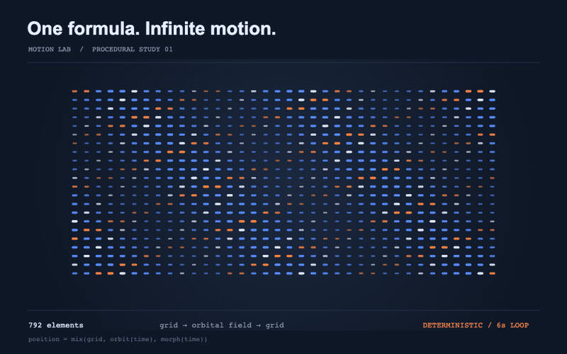

<div align="center">

# Motion Lab

**Un motore di rendering in codice, per il vibe motion.**

Descrivi un’idea. Costruisci le regole. Controlla ogni fotogramma.<br>
Motion graphics 2D e scene 3D, dal codice al video nello stesso studio locale.


[Guarda le demo](https://andrexes03.github.io/motion-lab/) · [Avvia lo studio](#inizia-da-qui) · [Esplora il motore](docs/ARCHITECTURE.md) · [Guide](docs/README.md)

</div>

## Il movimento nasce dalle regole



In questo test, **792 elementi** passano da una griglia a un campo orbitale con poche formule periodiche. Una composizione procedurale lega molti elementi alle stesse funzioni: il tempo, l’indice, il seed e i parametri diventano strumenti di design. Cambiare una regola cambia l’intero sistema, mantenendo le relazioni tra le parti. [Apri le formule dell’esempio](examples/procedural-field.html), la [spiegazione del test](docs/PROCEDURAL-EXAMPLE.md) e il [motore 2D](src/engine/procedural.js).

Motion Lab è pensato per lavorare insieme a un agente come Codex o Claude: descrivi il movimento, l’agente modifica sorgenti e ricette JSON, poi controlli la scena nel viewer e renderizzi localmente. Il risultato resta un progetto leggibile, modificabile e versionabile.

```text
Idea → codice e parametri → viewer → revisione del frame → render
              ↑___________________________|
```

## Dall’intenzione al controllo

Una generazione video da prompt, come quelle di Seedance o Kling, propone un risultato. Qui definisci direttamente geometrie, materiali, camera, traiettorie e timing: puoi correggere una curva, spostare un elemento o richiedere un preciso istante senza rigenerare la scena da un prompt.

- **Un sistema, molte varianti.** Ripetizioni, sfasamenti, oscillazioni e rumore con seed costruiscono movimento da poche regole.
- **Revisione puntuale.** La timeline richiede un tempo assoluto; puoi saltare a un fotogramma e confrontare le modifiche.
- **Parametri condivisi.** Palette, camera e movimento sono ricette JSON che puoi salvare, rivedere e ripristinare.
- **Stesso percorso fino al video.** Il motore alimenta sia la preview sia il render, con motion blur temporale e impostazioni di export esplicite.

After Effects e Cinema 4D offrono già strumenti procedurali. Qui il vantaggio è avere logica e parametri direttamente nei sorgenti: un agente può modificare un’intera famiglia di movimenti e tu puoi leggere il cambiamento in un diff. La riproducibilità dei pixel resta legata a codice, parametri, font e ambiente grafico.

## Uno studio per esplorare e renderizzare


Scegli la scena, esplora i preset, modifica il look e controlla il movimento nella timeline. Il viewer collega le modifiche alle ricette locali.


Scegli risoluzione, frame rate, campioni temporali e bitrate. Dal viewer puoi esportare MP4, WebM o ProRes.

## Un test del motore: Objects in play

[](https://andrexes03.github.io/motion-lab/)

Un breve test 3D mette insieme superfici, luci, movimento di camera e cinematica di un giroscopio. È un esempio di ciò che il motore può renderizzare; puoi esplorare i sorgenti e costruire altre composizioni.

**1080p · 25 fps · motion blur con 24 campioni · bitrate obiettivo 6 Mb/s · senza audio.**

[Guarda nel browser](https://andrexes03.github.io/motion-lab/) · [Scarica l’MP4](demo/objects-in-play.mp4) · [Apri la ricetta del render](demo/objects-in-play.project.json) · [Altre demo](demo/README.md)

## Inizia da qui

Il percorso verificato è **macOS con Node.js 22.12+ e Google Chrome**. Serve Internet per installare le dipendenze la prima volta.

```sh
git clone https://github.com/AndreXes03/motion-lab.git
cd motion-lab
npm ci
npm run viewer
```

Apri **http://127.0.0.1:4173/**. Scegli la scena 3D o la grafica procedurale, prova un preset e usa i controlli per creare una variante. Gli export dal viewer vengono salvati nella cartella Download.

Il server locale serve a salvare ricette e renderizzare; il build statico offre solo una parte delle funzioni dello studio. Gli script di rendering utilizzano il percorso di Chrome su macOS: Windows e Linux richiedono adattamento e non sono verificati. [Guida d’uso](docs/USAGE.md).

Per renderizzare la demo 3D con la ricetta condivisa:

```sh
npm run export -- --snapshot demo/objects-in-play.project.json --out renders/film.mp4 --width 1920 --height 1080 --fps 25 --temporal-samples 24 --bitrate-mbps 6
```

Per esplorare la grafica 2D:

```sh
npm run frame -- --scene procedural --time 2.8 --out renders/frame.png
npm run preview -- --scene procedural --out renders/preview.mp4 --temporal-samples 8
```

## Scegli da dove entrare

| Vuoi… | Apri |
| --- | --- |
| Capire il percorso dalla scena al video | [Architettura](docs/ARCHITECTURE.md) |
| Lavorare con un agente | [Workflow vibe motion](docs/AGENT_WORKFLOW.md) |
| Esplorare rendering, tempo e camera | [Motore](src/engine/) |
| Modificare una composizione | [Scene](src/scenes/) |
| Costruire oggetti e materiali | [Componenti](src/components/) |
| Cambiare controlli e interfaccia | [Viewer](src/viewer/) |
| Leggere le impostazioni del progetto | [Ricette JSON](project/README.md) |
| Renderizzare e verificare | [Strumenti locali](scripts/README.md) |
| Consultare tutte le guide | [Documentazione](docs/README.md) |

## Stato e licenze

Motion Lab è un laboratorio funzionante, in evoluzione. Audio, profondità di campo e import di modelli glTF non sono implementati. È stata rilevata una differenza nei pixel 2D dopo il passaggio 2D → 3D → 2D: riapri la scena prima di un confronto. [Verifiche e limiti](docs/VALIDATION.md).

Codice di **Andrea Salvo**, distribuito con [licenza MIT](LICENSE). I marchi e gli asset visivi delle demo mantengono i diritti dei rispettivi titolari; la licenza del codice non concede diritti sui marchi. [Dipendenze e avvisi](THIRD_PARTY.md). I binari di FFmpeg non sono inclusi.
