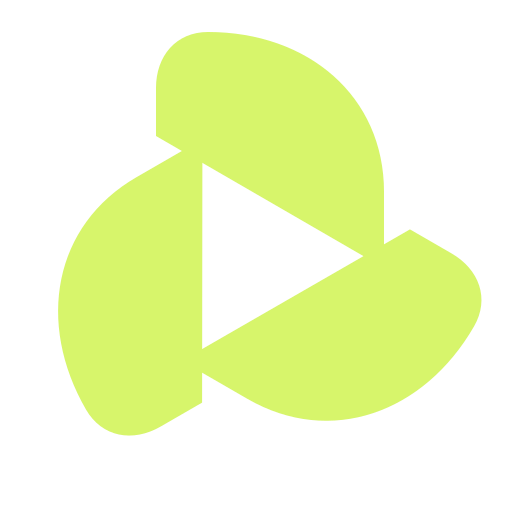
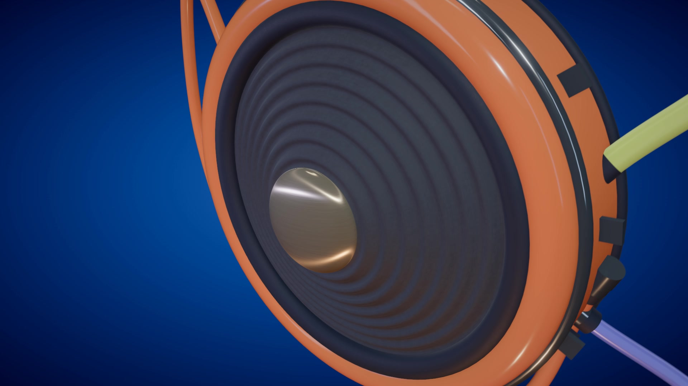

<div align="center">



# Framevolve

**Make motion. Keep control.**

An open-source studio for making editable 2D, hybrid and 3D motion with code, scene-specific tools and local rendering.

[See the films](https://andrexes03.github.io/motion-lab/) · [Open the browser studio](https://andrexes03.github.io/motion-lab/studio/) · [Setup](#run-motion-lab-locally) · [Guides](docs/README.md)

</div>

Build a scene with your coding agent. Shape its motion, lens, materials, lighting and grade in Framevolve. The agent works on the same scene code and recipe; the studio gives you a visual way to direct the next pass.

[](https://andrexes03.github.io/motion-lab/demo/pulse-1080.mp4)

PULSE · Blender Cycles · 1080p · 30 fps · 12.9 seconds. Click the frame to watch the film.

## Made in Framevolve

Five films show 2D graphics, hybrid compositions and detailed 3D scenes. Each one has its own source and editable recipe.

| Film | Scene | Watch | Source |
| --- | --- | --- | --- |
| PULSE | Sculptural sound objects, tactile materials and rhythmic 3D motion | [Film](https://andrexes03.github.io/motion-lab/#pulse) · [1080p MP4](demo/pulse-1080.mp4) | [Scene](src/scenes/pulse-demo.js) |
| CAMERA | Miniature worlds, optical hardware and an assembling diaphragm | [Film](https://andrexes03.github.io/motion-lab/#camera) · [1080p MP4](demo/camera-1080.mp4) | [Scene](src/scenes/afterhours-demo.js) |
| DOT | Character performance across 2D layouts and 3D forms | [Film](https://andrexes03.github.io/motion-lab/#dot) · [1080p MP4](demo/dot-1080.mp4) | [Scene](src/scenes/mascot-demo.js) |
| PLAY.EXE | A floating player, extruded lettering and a rhythmic city | [Film](https://andrexes03.github.io/motion-lab/#pop) · [1080p MP4](demo/pop-motion.mp4) | [Scene](src/scenes/pop-demo.js) |
| REPLAY | Editorial illustration, typography and spatial movement | [Film](https://andrexes03.github.io/motion-lab/#replay) · [1080p MP4](demo/replay-1080.mp4) | [Scene](src/scenes/replay-demo.js) |

The PULSE, CAMERA, DOT and REPLAY films are 1920 × 1080 at 30 fps with sound design. PULSE and CAMERA include separately licensed music; see [credits](THIRD_PARTY.md).

## Shape the scene

Every registered scene has an agent-selected set of controls and panel layout, chosen for its actual motion, lens, lights, materials or compositing needs. A complete control catalog remains available for deeper adjustments. The editor displays original OBJECTS keyframes and evaluated camera paths for procedural scenes, without changing the scene on opening. Curated light, compositing and interpolation presets are scene-specific and limited to four choices per palette.

Motion groups let you adjust a camera or object within one chosen shot window. Each target keeps its own curve and local timing; other groups, captions, cuts and total duration remain intact. Save versions, compare changes against a reference and undo or redo edits as you refine the scene.

The [product starter](https://andrexes03.github.io/motion-lab/studio/?scene=starter) includes reusable materials, lights, hardware and camera motion. See the [product kit guide](docs/PRODUCT_KIT.md) to build on those parts.

## Preview, render and sound

The interactive browser preview uses Three.js for 3D and Canvas for procedural 2D. Auto adjusts preview resolution as you work; Fast, Balanced and Sharp are available when you want a manual choice. These settings affect the preview only. In browsers with canvas recording support, the public Studio exports browser-rendered video at 720p or 1080p, plus PNG frames and JSON recipes. MP4 is offered when the browser supports its encoder; otherwise the Studio offers WebM. Browser video uses the real-time Three.js/Canvas path. Blender Cycles and prepared Mixed renders remain local-only; those renderer choices can be preserved in a recipe but are not executed on the public site.

The local app renders videos with Three.js as its standard route. Blender Cycles is an optional local path currently supported for PULSE; it is scene-specific and requires a successful local capability check. Other scenes need their own conversion and visual review. Mixed-render jobs combine prepared local image or frame-sequence inputs through an explicit compositing plan in Studio; choosing “mixed” alone does not create those inputs. See [renderer selection](docs/RENDERER_SELECTION.md) and [compositing](docs/COMPOSITING.md).

Framevolve also supports procedural music and movement-driven 2D or 3D sound effects. Read the [sound design guide](docs/SOUND_DESIGN.md).

## For the curious

Scenes are source code plus project parameters. The renderer samples a requested absolute time, making a frame inspectable and repeatable. Browse [scene modules](src/scenes/), [engine code](src/engine/) and [project recipes](project/).

An optional [path-traced still experiment](docs/PHOTOREALISM.md) studies PULSE materials with reflected light. It is a separate image-render path, not the motion-film renderer or a native After Effects or Cinema 4D project conversion.

<a id="run-motion-lab-locally"></a>

## Run Framevolve locally

The current setup is tested on macOS with Node.js 22.12 or newer and Google Chrome. Internet access is needed for the first installation.

```sh
git clone https://github.com/AndreXes03/motion-lab.git
cd motion-lab
npm ci
npm run viewer
```

Open <http://127.0.0.1:4173/>. Video renders go to Downloads. Windows and Linux have not been validated. Read [usage and export details](docs/USAGE.md) and [supported setup](docs/VALIDATION.md).

## Project guides

| Topic | Guide |
| --- | --- |
| Scene architecture and renderer | [Architecture](docs/ARCHITECTURE.md) · [Renderer selection](docs/RENDERER_SELECTION.md) |
| Product scenes and reusable parts | [Product kit](docs/PRODUCT_KIT.md) · [Scene source](src/scenes/) |
| Render and compositing workflow | [Usage](docs/USAGE.md) · [Compositing](docs/COMPOSITING.md) · [Scripts](scripts/README.md) |
| Sound | [Sound design](docs/SOUND_DESIGN.md) |
| Coding-agent workflow | [Agent workflow](docs/AGENT_WORKFLOW.md) · [Product-film skill](.agents/skills/motion-lab-product-film/SKILL.md) |
| Checks and limitations | [Validation](docs/VALIDATION.md) |
| Licenses | [Third-party assets](THIRD_PARTY.md) |

Created by Andrea Salvo. Source code is available under the [MIT License](LICENSE). Demo trademarks and third-party assets retain their respective rights. FFmpeg binaries are not included.
