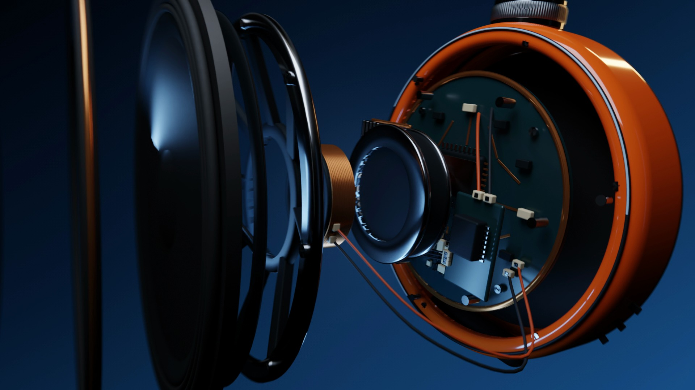

# Demos

[Watch in your browser](https://andrexes03.github.io/motion-lab/)

## Final showcase

| Film | Type | Duration | Watch / download |
| --- | --- | --- | --- |
|  | Cycles + 2D | 22.5 s | [Watch](https://andrexes03.github.io/motion-lab/#loop) · [1080p master · 30 Mbps](https://andrexes03.github.io/motion-lab/demo/loop-v13-electro-1080.mp4) |
|  | 3D | 12.9 s | [Watch](https://andrexes03.github.io/motion-lab/#pulse) · [1080p MP4](pulse-1080.mp4) |
|  | 3D | 15.4 s | [Watch](https://andrexes03.github.io/motion-lab/#camera) · [1080p MP4](camera-1080.mp4) |
|  | Hybrid | 16 s | [Watch](https://andrexes03.github.io/motion-lab/#dot) · [1080p MP4](dot-1080.mp4) |
|  | Hybrid | 15 s | [Watch](https://andrexes03.github.io/motion-lab/#replay) · [1080p MP4](replay-1080.mp4) |

**1920 × 1080 · 30 fps · sound design.** Hybrid combines 3D objects with 2D graphics and typography. PULSE/CAMERA use separately licensed music ([credits](../THIRD_PARTY.md)). All scenes remain editable in free-to-use, source-available Framevolve and render locally from code.

## Earlier studies

- [Procedural motion](procedural-techno.mp4): 1080p, 30 fps, 10 s, 4 temporal samples, target 12 Mb/s, 14.5 MB. Original techno at 132 BPM and 57 adaptive SFX. [Recipe](procedural-techno.project.json) · [Silent GIF](procedural-showcase.gif).

Films are rendered from the source code. The personal logo retains its owner's rights and is not covered by the code license.

- [PLAY.EXE / Pop Motion](pop-motion.mp4): 2D camera, extruded type, fish-eye and beat-synced motion. 1080p, 30 fps, 10 s, no motion blur. [Recipe](pop-motion.project.json).
