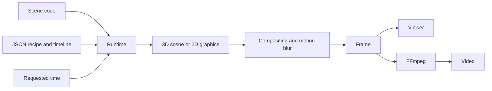

# Architecture

Motion Lab renders Three.js scenes and Canvas2D graphics locally. The viewer and CLI use the same frame calculation; the CLI encodes frames into video.

| Change or inspect | Source |
| --- | --- |
| Duration, dimensions, palette and text | [Configuration](../src/config.js) |
| Frame calculation | [Runtime](../src/engine/runtime.js) |
| Timeline and interpolation | [Animation](../src/engine/animation.js), [timeline](../src/engine/timeline.js) |
| Camera and paths | [Camera path](../src/engine/camera-path.js), [JSON tracks](../project/motion.json) |
| Geometry and materials | [Components](../src/components/), [materials](../src/components/materials.js) |
| Lighting, lens and effects | [Look recipe](../project/look.json), [compositing](../src/engine/composite.js) |
| Temporal motion blur | [Shutter sampling](../src/engine/temporal.js), [render CLI](../scripts/cli.mjs) |
| 2D graphics and typography | [Procedural engine](../src/engine/procedural.js), [2D demo](../src/scenes/procedural-demo.js) |
| Panels, presets and controls | [Viewer](../src/viewer/main.js), [studio schema](../project/studio.json) |
| Saving, versions and local renders | [Studio API](../scripts/studio-api.mjs) |

## Working with an agent

Describe the composition, shapes, materials and rhythm to Codex or Claude. The agent edits the scene, tracks or recipe. Inspect specific times in the viewer, adjust parameters, compare results and render.

The engine works with explicit, versioned files. It does not interpret prompts itself or reconstruct 3D models from references.

## Adding a scene

A 3D module exports `createScene(renderer, config)` and returns the scene, camera, update function and overlay. The 2D mode renders to a canvas. Register scenes in [runtime](../src/engine/runtime.js), [configuration](../src/config.js) and the [control schema](../project/studio.json).

Updates must depend on absolute time. Avoid playback timers, accumulated frame state and unseeded randomness. This supports repeatable seeking and rendering within the same browser and GPU configuration.

[Usage](USAGE.md) · [Agent workflow](AGENT_WORKFLOW.md) · [Docs index](README.md)

## Optional still-image path tracing

`experiments/photoreal/` is an isolated renderer experiment, installed separately from the main application. `scripts/photoreal.mjs` serves it to headless Chrome. It freezes a product-kit model, converts supported materials, expands static instances, renders a plain raster reference, accumulates path-traced light with bounded GPU readbacks, then captures the target explicitly. It is not imported into the studio build or the film exporter. [Reproduction, measured settings and compatibility limits](PHOTOREALISM.md).
