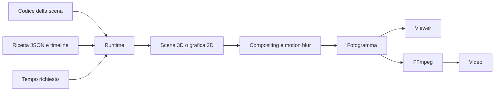

# Dal codice al video

Motion Lab è un motore locale di rendering per scene Three.js e grafica Canvas2D. Il viewer permette di esplorare il risultato; la CLI calcola i fotogrammi allo stesso modo e li codifica in video.

## Scegli cosa esplorare

| Voglio capire o cambiare… | File da aprire |
| --- | --- |
| Durata, dimensioni, palette e testi | [Configurazione](../src/config.js) |
| Come viene calcolato un frame | [Runtime](../src/engine/runtime.js) |
| Timeline e interpolazione | [Animazione](../src/engine/animation.js), [timeline](../src/engine/timeline.js) |
| Camera e traiettorie | [Percorso camera](../src/engine/camera-path.js), [tracce JSON](../project/motion.json) |
| Geometrie e materiali | [Componenti](../src/components/), [materiali](../src/components/materials.js) |
| Luce, lente e finitura | [Ricetta look](../project/look.json), [compositing](../src/engine/composite.js) |
| Motion blur temporale | [Campionamento dell’otturatore](../src/engine/temporal.js), [render CLI](../scripts/cli.mjs) |
| Grafica 2D e tipografia | [Motore procedurale](../src/engine/procedural.js), [demo 2D](../src/scenes/procedural-demo.js) |
| Pannelli, preset e controlli | [Viewer](../src/viewer/main.js), [schema dello studio](../project/studio.json) |
| Salvataggio, versioni e render locali | [API dello studio](../scripts/studio-api.mjs) |

## Un ciclo di vibe motion

1. Descrivi l’idea a Codex o Claude: composizione, forme, materiali e ritmo.
2. L’agente modifica la scena, le tracce o la ricetta JSON.
3. Ispezioni tempi precisi nel viewer, anche andando indietro.
4. Correggi un parametro o un oggetto e confronti il risultato.
5. Renderizzi un frame, una preview o il film completo.

L’agente lavora su file espliciti e versionabili. Il motore non interpreta da solo i prompt e non ricostruisce automaticamente modelli 3D dalle reference.

## Come aggiungere una scena

La scena 3D è un modulo che esporta `createScene(renderer, config)` e restituisce scena, camera, funzione di aggiornamento e overlay. La modalità 2D renderizza sul canvas. I punti di integrazione attuali sono [runtime](../src/engine/runtime.js), [configurazione](../src/config.js) e [schema dei controlli](../project/studio.json): aggiungere una scena richiede collegarla in questi file.

Ogni aggiornamento deve dipendere dal tempo assoluto. Non usare timer di playback, accumuli tra frame o casualità non inizializzata. Questo permette seek, confronto e render ripetibili nella stessa configurazione di browser e GPU.

[Guida d’uso](USAGE.md) · [Workflow per agenti](AGENT_WORKFLOW.md) · [Torna all’indice](README.md)
