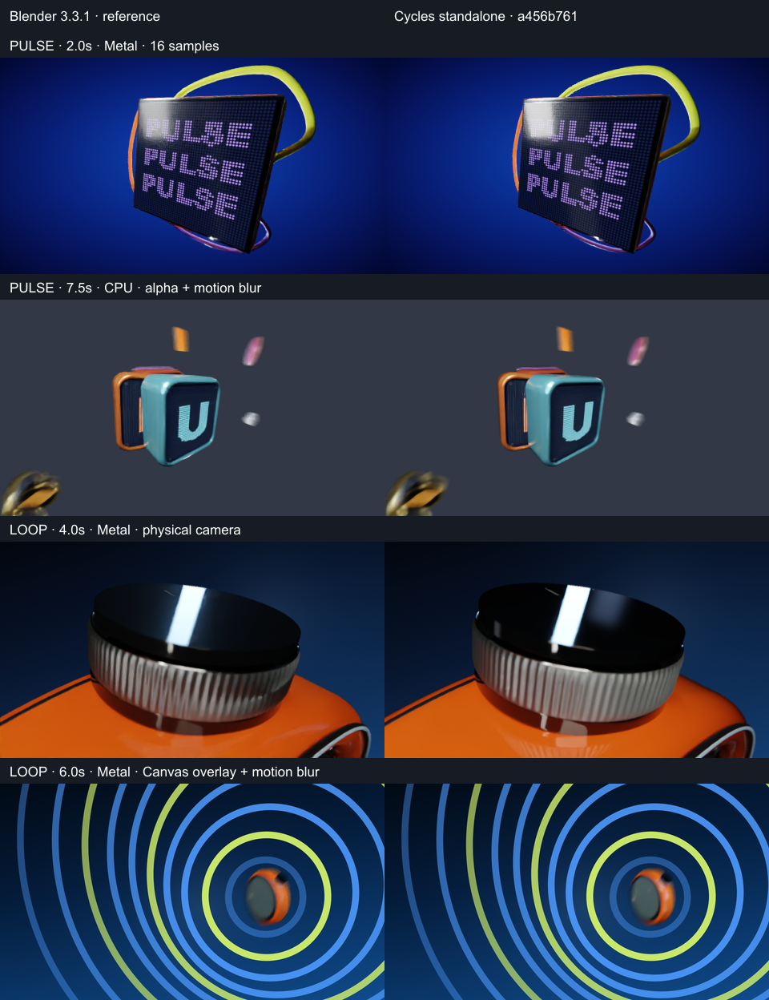
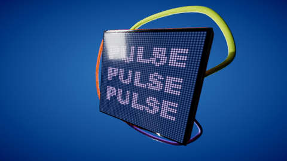
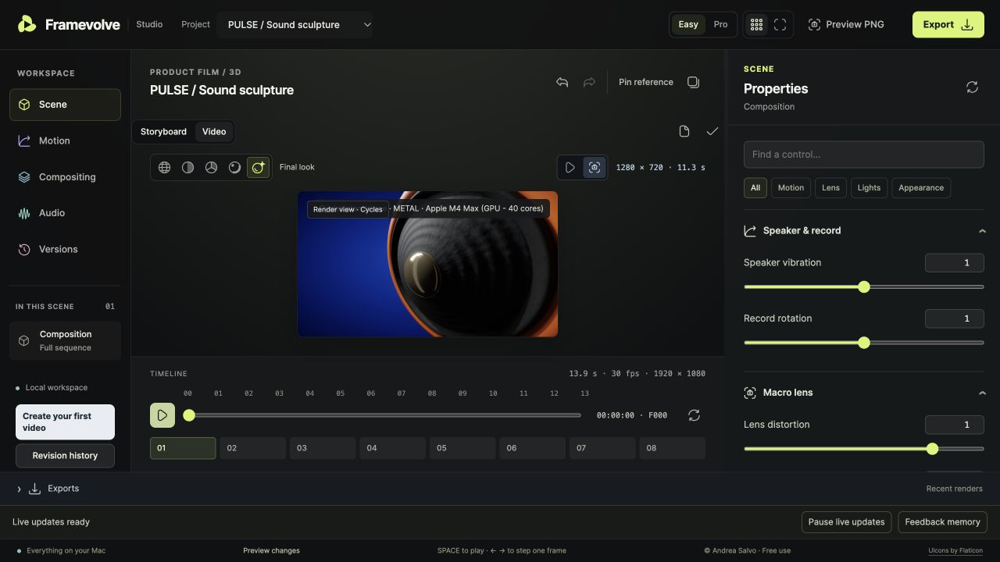

# Standalone Cycles: development verification, 2026-10-22

**Working development integration; not a stable downloadable component.** Started from `main` `347e315` (PR #38) in an isolated checkout and branch. No active user checkout, project, Blender installation or existing Studio server was changed.

## What is implemented

The default Cycles path runs `framevolve-cycles`, a C++ host linked directly to the pinned Cycles libraries. It has no Blender executable, `bpy`, Python runtime or Blender UI dependency. The old adapter remains available only through explicit developer CLI `--backend blender-reference`. Three.js, WebGL, Canvas and Chromium still prepare scenes and provide interactive previews. There is no silent fallback for an explicit Cycles request.

The host reuses the upstream XML node reader after auditing its sockets and mesh support. The adapter transfers mesh groups, normals, tangents, UVs, hierarchical and instance transforms, shader graphs, baked material/texture changes, camera pose/FOV/physical DOF, lights and shutter samples. A small reader patch transfers light object motion. The host adds real device probing, progress, error exits, denoised combined output and OCIO Filmic/Medium High Contrast with straight PNG alpha. The stock standalone gamma-only output is not used.

Scene support is restricted to PULSE and LOOP, exposed as experimental under the development runtime override. Native render work is serialized (one worker); Studio keeps its existing active-render reservation. Viewport progressive passes, single-frame export, MP4 encoding, Canvas composition and audio use the same job path. Local export and Render View now have actual cancellation, and report the backend and device emitted by the process.

## Actual evidence

Machine: macOS 26.6.2, Apple M4 Max. Native source revision `a456b761034dda42c32eef9f4aae0fa5a5c9f604`; library revision `5a140a8ccc8c070221b1b06e2c6f89f136c5758d`. Metal reported **Apple M4 Max (GPU - 40 cores)**. The existing comparison installation is **Blender 3.3.1**, not the same Cycles revision.

- PULSE at 2.0s: Metal, 480×270, 16 samples, same camera/material placement. Bright highlights and denoising differ slightly.
- PULSE at 7.5s: CPU, 480×270, 32 samples, transparent PNG and motion blur. Alpha is retained; the standalone blur and highlighted edges differ slightly from the old renderer.
- LOOP at 4.0s: Metal, 480×270, 16 samples. Framing, geometry and focus transfer; the knob's reflection and ribbed-material response visibly differ. This is **not pixel parity or creative approval**.
- LOOP at 6.0s: Metal, motion blur, native Canvas rings above the beauty pass. The overlay geometry, timing and placement are retained.
- PULSE MP4: six frames at 30 fps, 0.2s, H.264 plus AAC, complete decode and matching stream duration. LOOP MP4: six frames at 12 fps, 0.5s, H.264, complete decode. LOOP had no explicit soundtrack supplied for this proof; edited-track playback was not assessed.
- CPU rerender in a separate HOME with empty environment and OS sandbox denying Blender, Cycles source/build/tooling and `/Library/Developer`: completed with **identical pixel bytes** to the corresponding native CPU render. This proves the renderer runtime does not need Blender or compilation tools. It does **not** prove a complete first-use installer on a clean user account.
- Actual local Studio API viewport job: completed 64×64 Metal PNG, progressive stages 1 and 2 observed. A second real native job was cancelled during scene baking, retained its reservation until child exit, reached `cancelled` and had no download. Real cancellation during GPU tracing and end-to-end user clicks in the final installer remain unverified.
- Three.js native Storyboard browser check, browser MP4 export with audio/progress/cancellation, and standard local frame API passed. Final production build and its required prebuild contracts passed.
- Focused adapter and component tests passed: transform/shutter/camera/material/UV fixtures; explicit unavailable GPU rejection; checksum failure, unsafe archive entries, interrupted download retry, compatible reuse and failed-update preservation. The install validator is mocked in package fixtures: those tests do not substitute for signing/notarization or real download proof.

[Machine-readable measurements](cycles-evidence/results.json) record frame differences and clip metadata. Low sample counts and different Cycles generations mean pixel differences are diagnostic only. These are deliberately small integration probes, not complete-film delivery tests or performance benchmarks.

## Current release status (later update, 2026-10-22)

The color/licensing blockers above have been resolved for the new payload: it uses the self-contained, permissively licensed OCIO ACES SDR configuration instead of Blender Filmic data. OpenImageIO was rebuilt with PNG/HDR/PNM/OpenEXR only, excluding embedded LGPL libheif and unused codecs. Exact sources, hashes and dependency notices are included. Root Framevolve licensing is unchanged. Earlier comparison images and measurements in this report used the previous Filmic development payload and are historical evidence, not pixel comparisons of the ACES payload.

The new payload completed real 480×270 PULSE/Metal and LOOP/CPU frames. The production UI build passed, component tests passed 10/10 and focused setup tests passed 3/3. The optional download checkbox, nested component app, macOS manual-authorization flow and activation only after successful native probing are implemented. No Developer ID is required for this preview path; quarantine and Gatekeeper remain intact.

**Package verified:** macOS Apple Silicon preview `0.1.0-preview.2` is published as GitHub release `cycles-v0.1.0-preview.2`. The real component manager downloaded 57,536,471 bytes, verified SHA-256 `461dc04c5cb4156faf49933567bda0bbf523e11170eba97dc56622472ce33af6`, preserved quarantine, and opened the normal macOS security prompt. The user authorized it with Open Anyway. Version preview.2 fixes App Translocation by writing its approval under Application Support. Activation checked the native executable again; a PULSE 480×270/16-sample frame then completed on Metal from the installed package, without a development runtime override or Blender. The original preview.1 is superseded.

The single Framevolve setup offers an optional Cycles download checkbox and Studio can add/remove the component later. The nested approval helper is not a second Desktop application. The component remains labelled preview, limited to PULSE/LOOP on macOS Apple Silicon.

Remaining visual scope: PULSE/LOOP only; ACES response differs from Filmic; custom browser shaders/post effects and deformation/texture motion blur remain unsupported. Long-film seeking, full soundtrack review and GPU-tracing cancellation have not been verified. Other platforms are unavailable.

## Usable local installation (2026-10-22)

A separate persistent Studio is running at `http://127.0.0.1:4190/`, using the already-built native runtime. The user's existing Studio on port 4174 remains untouched. A local **Framevolve Cycles.app** launcher on the Desktop starts/reuses this isolated Studio, without requiring terminal input, compilation, a Developer ID certificate or Blender. It depends on the existing local checkout/runtime paths; it is not a portable public installer.

Open that launcher, choose PULSE or LOOP, then **Export → Renderer → Cycles**. **Render view** renders the current frame; **Export MP4** renders the video. Start with Draft for quick feedback. A real UI-triggered PULSE frame completed at 1280×720 in 11.3s with the device label **METAL · Apple M4 Max (GPU - 40 cores)**. This adds actual Render View user-flow evidence; complete installer/download approval remains outstanding.

## Interface once a stable component is published

Setup will offer optional **Rendering Cycles**. In local Studio choose **Cycles**, use **Install Rendering Cycles** if offered, then **Render View** for the current frame or Export for video. The panel offers update/removal of the component only. Today the release is unavailable; these instructions describe the implemented flow, not a published installable package.
