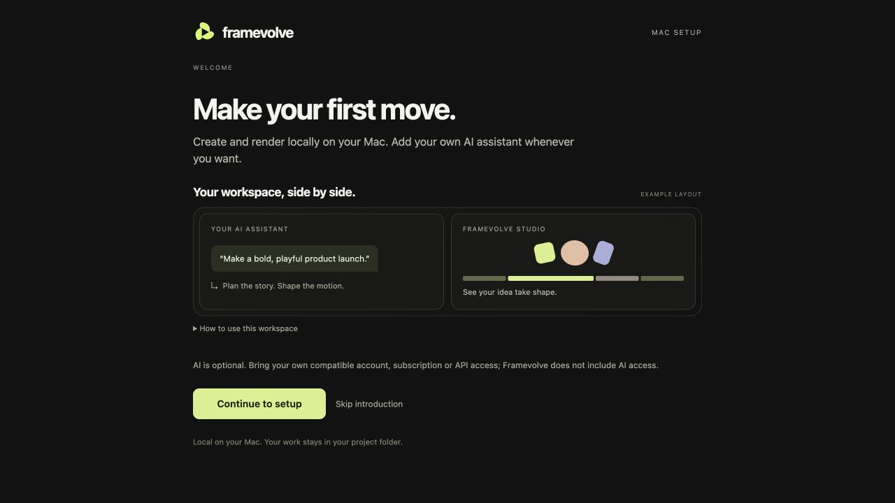
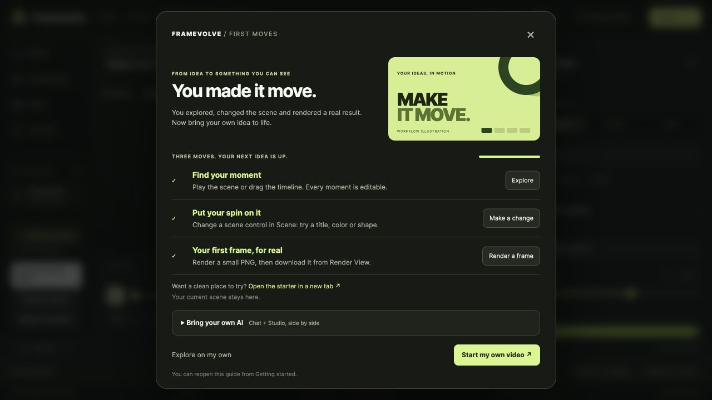
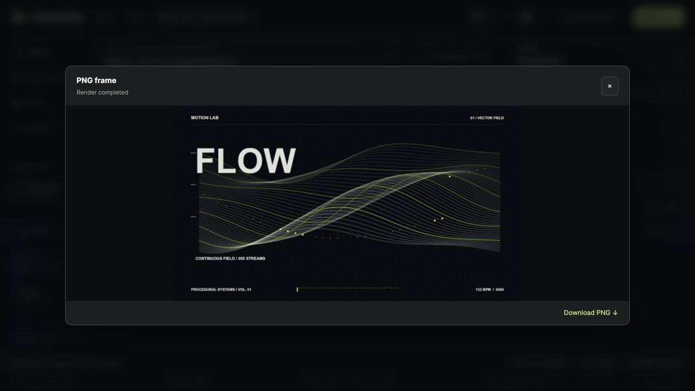

# Installed Framevolve: first moves

The onboarding belongs to the downloaded/local product. The public demo and render-worker pages do not mount it.

## Setup

The welcome screen introduces the workspace with a deliberately labelled **example layout**: a local coding assistant beside Framevolve Studio. Continue or skip opens the installation choices. Returning to **How it works** preserves the current selections. Existing setup receipts open the setup stage directly.

AI is optional. Account/subscription/API access and charges belong to the selected compatible provider. Selecting a provider is not sign-in, MCP registration, or proof of an available integrated browser. The ready screen supplies the actual local Studio URL and a tailored starter prompt. The existing **Create with AI** action opens the selected CLI in Terminal; desktop/editor users can open the project folder in their own assistant instead.

## Studio

Setup includes a first-run invitation in its Studio URL. The guide opens automatically only for that invitation (or its separate starter tab), while progress is unseen and no active render/modal is present. Ordinary existing sessions stay unchanged. **Getting started** in the sidebar always reopens the guide.

Three steps are observed from real work: a play/seek interaction, a scene-control edit, and a newly completed render with an output URL. A render click or failed/cancelled job is not completion. The guide's still uses the selected engine, preserves aspect ratio and limits the longest edge to 640 pixels with one temporal sample. It does not change the saved export settings or conceal unavailable renderers.

The starter opens in a separate `noopener` tab to preserve the current scene and its session draft. **Start my own video** opens the existing guided brief; it does not create or overwrite a project automatically.

**Bring your own AI** contains a schematic, project folder, real Studio link and copyable prompt. It explains the integrated-browser/local-access requirement and Safari/Firefox fallback. No credentials are requested and no prompt is sent to a provider automatically.

Progress is stored per installation in `.motion-cache/onboarding.json`, independent of browser and port. Updates merge completed steps and use an atomic local write. The session API requires loopback, exact origin and a session token for writes. Neither project files nor renderer settings are modified by saving progress.

## Verification — 22 October 2026

- Setup welcome and compact installation stage visually inspected at 1280 × 720; install action remains visible. The temporary setup fixture exercised the ready state without installing anything on the user's active copy.
- Real isolated Studio: play, typed scene-control edit, guide-triggered **Skia CPU 640 × 360 PNG**, successful download link, all three steps completed, reload and reopen retained progress. Brief handoff and starter-prompt copy checked.
- Focused tests cover concurrent progress merging, skip persistence, invalid data, linked-file rejection and origin/token guards. Setup API tests and the required build contracts passed.
- The setup browser regression covers intro/skip/back, preserved selections and existing installation flow in macOS CI. The local Playwright cache was unavailable, so manual UI verification used the existing integrated browser without downloading another rendering browser.

This does not extend renderer scene support or add embedded AI authentication. Existing Cycles platform, scene and signing limitations still apply. See [Mac setup](MAC_SETUP.md) and [native engine scope](NATIVE_PRODUCTION.md).
