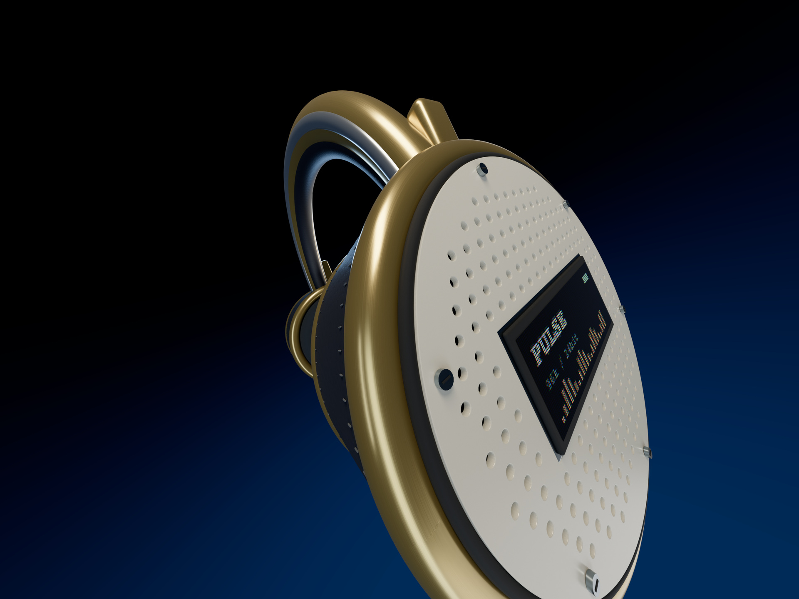

# Photorealism — experimental still renderer



An optional path-tracing experiment using the existing PULSE headphone model, with a still-only detail pass. A 114° close wide-angle shot brings the perforated ceramic grille, rubber seal, brushed metal and leather into the foreground. Light reflects between these surfaces; the floating composition uses a black-to-deep-blue gradient without a floor or horizon. The main interactive studio and published films continue using their existing renderer.

## Reproduce the comparison

From the repository root, after the normal `npm ci`:

```sh
npm ci --prefix experiments/photoreal --ignore-scripts
node scripts/photoreal.mjs --asset headphones --width 2880 --height 2160 --samples 2048 --out renders/photoreal-lab/my-test
```

Tested on macOS with Google Chrome. Set `CHROME_PATH` if Chrome is elsewhere. A local Vite server opens only on `127.0.0.1`; Chrome renders in the background. Output directories must be new so prior images are preserved.

Outputs: `raster.png`, `pathtraced.png` and `metrics.json`. The command fails on browser errors or an identical raster/path capture. Start with 640 × 480 and 64 samples to inspect framing before spending time on the final image. Samples above 2048 or dimensions above 4096 are rejected to limit accidental heavy jobs.

## What the comparison measures

Both views use the same frozen model, transforms, surface maps, 114° camera, studio environment and three rectangular lights. The warm key and narrow cool rim give the materials different reflections while keeping some surfaces in shadow. The grille openings are real geometry, with backing, gasket and six fasteners per side; they are not painted dots. The earcups have modeled seam stitches and very small geometric displacement on the leather shell. Sparse roughness scratches affect the metal reflections; a fingerprint roughness mask affects the display highlights without being painted into its color. These details are deliberately subtle. A recessed display uses a procedural RGB subpixel emissive map, a dark seal and a metal bezel. Its glossy surface is a single-layer approximation; a separate refractive cover was tested and rejected because it obscured the screen in this renderer. The path-traced image uses 2048 samples per pixel and eight light bounces. Both apply AgX tone mapping with exposure 1 and sRGB output. No bloom, ambient-occlusion post effect, denoising, depth of field, motion blur or image-generation service is involved.

The raster view is a plain rendering of this test scene, **not the production film's finished composite**. The film renderer already has separate shadow/compositing tools. This test isolates the rendering method; it is not a claim that the whole production pipeline has been replaced or objectively surpassed.

[Raster image](../demo/photorealism-raster.jpg) · [Path-traced PNG](../demo/photorealism.png) · [Recorded settings and timing](../demo/photorealism-metrics.json) · [Native-resolution display crop](../demo/photorealism-detail.jpg)

The published 2880 × 2160 / 2048-sample run took approximately 291 seconds for the accumulation loop, with 338,308 triangles after expanding 352 stitch instances. Timing in the manifest is measured on the local machine. `pathMs` includes sample submission, GPU readback checkpoints every 16 samples and progress callbacks, but excludes browser startup, asset construction and final PNG encoding. `setupMs` measures path-tracer scene setup separately. `rasterMs` includes a cold shader compilation. These are diagnostics, not a reliable speed comparison or an estimate for rendering a film.

## Reuse the implementation

- `experiments/photoreal/scene.js` builds the shot from the product kit, reuses Framevolve's leather/metal maps and supplies a procedural floating-point studio environment. Change this file to art-direct another still. `headphone-detail.js` adds perforated ceramic, matte rubber, fabric cushioning, titanium fasteners, stitching and a subpixel display only to the experimental instance; the film model is preserved.
- `freezeScene()` clones visible geometry and materials into a static snapshot, baking transforms and expanding instances for the path tracer. It reports triangle/material conversions. Source assets are not mutated; dispose the returned snapshot when finished.
- `experiments/photoreal/main.js` runs both renderers and exports the actual path-tracing buffer with an explicit full-canvas presentation step. Small synchronous readbacks prevent headless Chrome from accumulating an oversized GPU command queue. This prevents an old raster frame or retained depth buffer from masquerading as a path-traced output.
- `scripts/photoreal.mjs` handles validation, the local server, Chrome, PNG capture and metrics. The current shot supports `headphones`, `camera` and `turntable`; only the headphone beauty image has been visually inspected for this experiment.

The optional installation pins Three.js 0.181.2, three-gpu-pathtracer 0.0.24, three-mesh-bvh 0.9.1 and xatlas-web 0.1.0. They are isolated from the application's Three.js 0.186.1 installation and normal build. Do not upgrade these individually without rerunning the comparison. This uses the pinned WebGL API; newer upstream development may use a different API.

## Known limits

- Clearcoat produced black coated surfaces in the tested path tracer. The adapter disables **only this secondary coating in both comparison views**, counts the affected materials and preserves base metallic/roughness shading. The source film materials remain untouched. This limitation is not solved by raising sample count.
- Standard/Physical materials are supported. Basic materials are converted to Standard; custom material shader modifications are omitted and counted. Unsupported material types fail explicitly. Custom shader parity is not guaranteed.
- The adapter handles static meshes and basic instances. Skinned/morph animation, per-instance color, negative-scale winding and arbitrary animated scene capture are outside the current validated scope.
- Noise can remain in dark reflections. More samples trade time for less noise, not better geometry. This example is not denoised.
- Thin transmission/glass did not produce a usable display cover in this test. Depth of field and temporal motion blur have not been validated here. This is a still-image tool, not a replacement video exporter.
- Additional detail must still come from model construction, surface scale and photography. The experiment improves light transport; it does not turn a simple mesh into a detailed manufactured object.

For future work: keep the existing renderer for animation iteration, use this optional path for approved hero stills, then validate material parity and animated geometry updates before attempting a video path.

Upstream: [pinned WebGL path tracer](https://github.com/gkjohnson/three-gpu-pathtracer/tree/v0.0.24), [licenses](../THIRD_PARTY.md).

## Validation

Run `node scripts/test-photoreal.mjs` for static transform baking, instance expansion, coating adaptation, borrowed-texture ownership and unsupported-material checks. The normal `npm run build` verifies that the optional experiment does not enter the studio bundle. Review the actual images as well; passing these checks does not establish creative quality.
