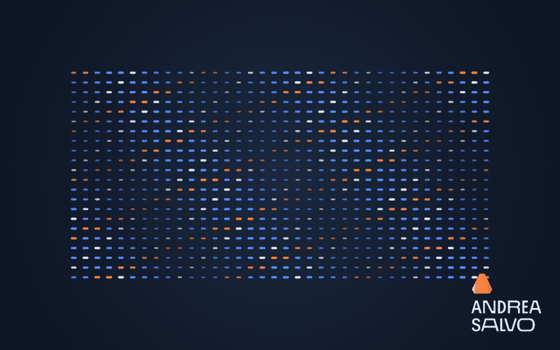

# Procedural motion: one rule, 792 elements



The GIF shows only the animation and Andrea Salvo's personal logo. A grid folds into an orbital field and returns to its starting state. Every element gets its position, orientation, scale and brightness from the same clock and a few equations. There are no individual keyframes, stored simulations or video-generation prompts.

The example is a small standalone Canvas 2D study of the same code-driven workflow used by Motion Lab's Three.js scenes. It is deliberately separate from the 3D product-film demo.

## Try it

Open [`examples/procedural-field.html`](../examples/procedural-field.html) in a browser. No server or build is required. The source is a single editable file.

Change the `SETTINGS` object near the top of the file:

| Control | Default | What it changes |
| --- | --- | --- |
| `columns` | `36` | Elements per ring and grid row |
| `rows` | `22` | Ring count and grid height |
| `duration` | `6` | Loop duration, in seconds |
| `twist` | `2` | Petal-wave cycles during the loop; use integers for seamless loops |
| `petalAmplitude` | `14` | Organic distortion of the orbital field |

The central rule is:

```js
position = mix(grid, orbit(time), morph(time));
morph = smooth((1 - Math.cos(phase)) / 2);
phase = 2 * Math.PI * time / duration;
```

The exact implementation lives in `position()` and `renderAt()`. Calling `renderAt(3)` gives the same frame every time. Density, timing and shape remain explicit editable decisions; changing a parameter rebuilds the whole field coherently.

After Effects expressions and Cinema 4D's procedural tools can also create fields like this. Here, the advantage is that the complete rule is short, inspectable source code: easy to revise with a coding assistant, version, reuse and render at an exact time. It avoids manually maintaining hundreds of separate animated elements.

## Recreate the GIF

From the repository root, with Google Chrome installed:

```sh
npm install
node examples/render-procedural.mjs
```

The script uses Playwright and the bundled FFmpeg dependency. It checks that frames at `0` and `duration` are byte-identical, renders 108 explicitly timed frames, and writes an 800 × 500 GIF plus a full-size poster to `demo/`. The GIF repeats indefinitely. Temporary frame files are removed after encoding.
