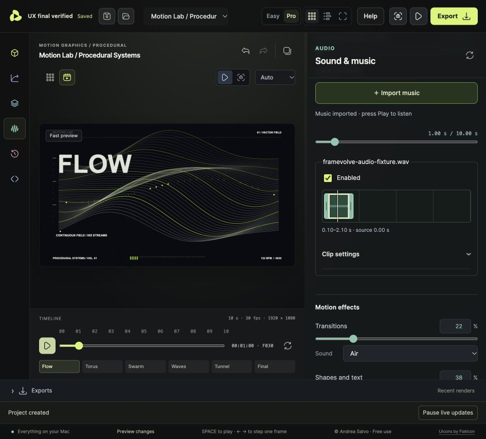
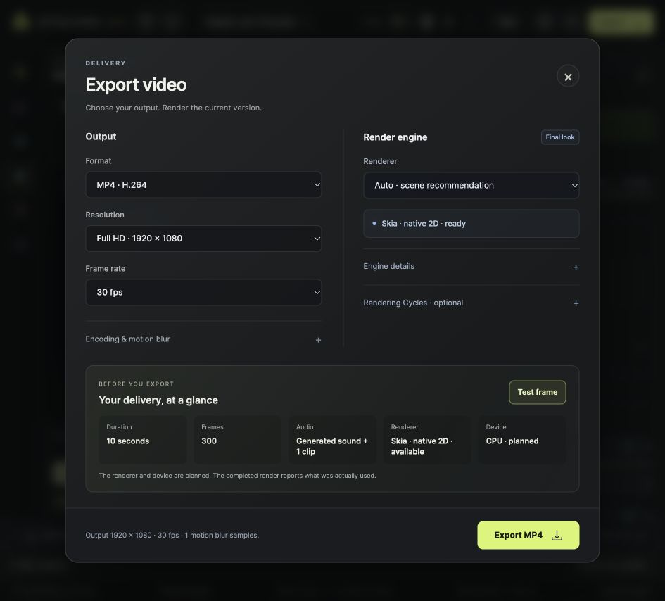

# Studio workflow improvements

Implements UX audit items 1, 3, 4, 5, 6, 7 and 8. Conflict recovery (item 2) remains outside this change.

- Scene examples ask whether to create a project or replace the current scene. Replacement preserves a named recovery copy. Cancel leaves the current scene intact.
- Help stays available in the header, including the narrow chat/Studio layout. It links to first steps, the user's AI setup and the video brief.
- Global master and mute affect generated and imported audio across preview, browser export and native export. The original 80% mix level is preserved.
- Project management provides Rename, Duplicate, Trash and Restore. The open project must be closed by opening another before trashing it. Trash does not permanently delete files.
- Portable export reviews included files, missing/external references and destination requirements. Downloads are tied to the reviewed revision.
- Export shows duration, frame count, audio, renderer availability and planned device. Test frame uses the current export settings; it never starts automatically.
- Imported clips have waveforms, drag/keyboard move and trim, a seek ruler and precise numeric settings/fades.

## Verification

Checked in the actual Studio at 945 × 854: Cancel and Replace example, recovery copy, New, Rename, Duplicate, Trash/Restore, reviewed `.framevolve` download, imported WAV, waveform movement and audio ruler seeking. A single 1920 × 1080 Procedural test frame completed with native Skia CPU. Screenshots below use a synthetic audio fixture.

Focused tests cover project revision/rollback guards, export revision binding, polling focus, PCM master/mute parity, waveform move/trim and browser-export audio. The production build and its contracts passed. No full-film or Cycles benchmark reruns were required for this interface change.

Computed external paths cannot all be discovered by package review. Mixed export retains its prepared soundtrack; it must be rebuilt after audio edits. Device information is a plan until a render reports the device actually used. The existing Cycles signing/platform limitations remain unchanged.
